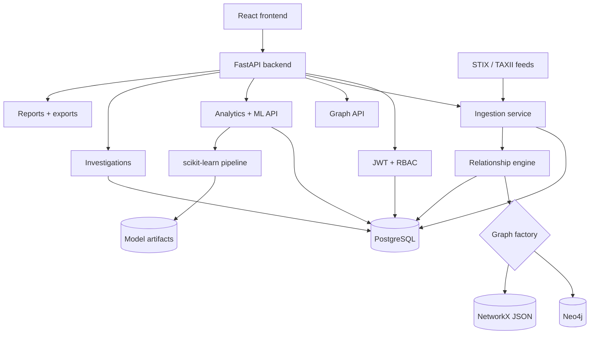

# THREAT-GRAPH

AI-powered cyber attack relationship mapping, investigation, and advisory prediction system.

Repository: `https://github.com/Njbalamani/THREAT-GRAPH`

Main application folder: [`threat-graph/`](threat-graph/)

License holder: **N J Bala Manikantan** (`n j bala manikantan`)

---

## Repository purpose

This GitHub repository is the deployment home for **THREATGRAPH**, a full-stack security intelligence platform that turns scattered indicators, logs, events, and threat intelligence feeds into a connected investigation graph.

The repository is intentionally organized with one top-level application directory:

```text
THREAT-GRAPH/
  README.md              this outer README
  LICENSE                outer license
  threat-graph/          inner project folder
    README.md            detailed project README
    LICENSE              project license
    backend/             FastAPI application
    frontend/            React application
    docs/                architecture, ER, API, deployment docs
    docker-compose.yml   full local stack
```

The project is not a static mockup. It includes working ingestion, persistence, graph construction, analytics, machine learning, investigations, reporting, authentication, tests, and a browser interface.

---

## Important prediction notice

THREATGRAPH uses machine learning to prioritize analyst attention. It does **not** declare confirmed attacks.

Every prediction returned by the API and displayed in the UI contains:

- `prediction_only: true`
- `confirmed: false`
- a probability score
- a risk level
- an explanation
- the model version that produced it

Observed relationships come directly from evidence. Inferred relationships are analytical connections that require validation. The platform keeps these two concepts separate everywhere: graph storage, API responses, exports, and the user interface.

---

## What the system does

THREATGRAPH accepts data from several sources:

- manually created indicators
- pasted raw intelligence text
- uploaded JSON, CSV, log, and STIX files
- configured STIX, TAXII, JSON, CSV, and log feeds
- bundled sample datasets

It then:

1. detects the input format
2. extracts and validates indicators such as IPs, domains, hashes, URLs, and emails
3. deduplicates indicators in PostgreSQL
4. stores raw security events
5. builds a graph of relationships
6. distinguishes observed evidence links from inferred analytical links
7. computes graph analytics such as clusters, important nodes, and anomalies
8. trains a risk model from available labels and graph features
9. produces advisory predictions with explanations
10. lets analysts create cases, link indicators, add notes, and review timelines
11. exports reports and machine-readable datasets

---

## High-level architecture



### Technology stack

| Layer | Technology |
| --- | --- |
| Frontend | React, TypeScript, Vite |
| Visualization | Cytoscape.js, Chart.js |
| Styling | Custom CSS, no Bootstrap |
| Backend | FastAPI, Python 3.12 |
| Relational store | PostgreSQL through SQLAlchemy |
| Graph store | Neo4j through Cypher, NetworkX fallback |
| Authentication | JWT bearer tokens, bcrypt password hashing |
| Machine learning | scikit-learn, NumPy, joblib |
| Reports | ReportLab PDF, CSV, JSON, GraphML exports |
| Testing | pytest, Ruff, TypeScript compiler |
| Containers | Docker, Docker Compose, nginx |

---

## Outer repository structure

```text
.
├── README.md
├── LICENSE
└── threat-graph
    ├── README.md
    ├── LICENSE
    ├── .env.example
    ├── .gitignore
    ├── docker-compose.yml
    ├── backend
    │   ├── Dockerfile
    │   ├── app
    │   │   ├── api
    │   │   ├── core
    │   │   ├── graph
    │   │   ├── ingestion
    │   │   ├── ml
    │   │   ├── models
    │   │   ├── schemas
    │   │   └── services
    │   ├── pyproject.toml
    │   ├── pytest.ini
    │   ├── requirements.txt
    │   ├── sample_data
    │   └── tests
    ├── docs
    │   ├── api.md
    │   ├── architecture.md
    │   ├── deployment.md
    │   └── er-diagram.md
    └── frontend
        ├── .env.example
        ├── Dockerfile
        ├── nginx.conf
        ├── package.json
        ├── package-lock.json
        ├── src
        │   ├── components
        │   └── pages
        └── tsconfig.json
```

---

## Start here

If you want to run the application:

1. Open [`threat-graph/README.md`](threat-graph/README.md).
2. Follow the local development or Docker instructions.
3. Sign in with the default local administrator account.
4. Seed the sample datasets.
5. Explore the graph and analytics screens.

If you want to understand the design:

1. Read [`docs/architecture.md`](threat-graph/docs/architecture.md).
2. Read [`docs/er-diagram.md`](threat-graph/docs/er-diagram.md).
3. Read [`docs/api.md`](threat-graph/docs/api.md).
4. Read [`docs/deployment.md`](threat-graph/docs/deployment.md).

If you want to deploy:

1. Copy `threat-graph/.env.example` to `.env`.
2. Replace all default secrets and administrator credentials.
3. Run `docker compose up --build` from the `threat-graph/` directory.
4. Verify the API health endpoint.
5. Verify the frontend login screen.
6. Seed or ingest production-approved data.

---

## Default local login

The default credentials are for local development only:

```text
Username: admin@threatgraph.local
Password: ChangeMe123!
```

Change these before any deployment that is reachable outside your machine:

```text
ADMIN_EMAIL
ADMIN_PASSWORD
SECRET_KEY
POSTGRES_PASSWORD
NEO4J_AUTH
```

---

## Feature overview

### Ingestion

- JSON event ingestion
- CSV event ingestion
- raw log and text ingestion
- STIX bundle parsing
- configured feed polling
- file size validation
- rejected-record reporting
- ingestion job audit trail

### Indicator management

- indicator types: IP, domain, hash, URL, email
- severity levels: low, medium, high, critical
- confidence scoring
- tags
- source attribution
- STIX identifier preservation
- analyst confirmation state
- search and filters

### Graph mapping

- real graph relationships
- observed and inferred provenance
- relationship strength and confidence
- neighborhood exploration
- shortest paths
- graph statistics
- Cypher-based Neo4j storage
- NetworkX fallback storage

### Analytics

- community detection
- important node ranking
- anomaly detection
- label source reporting
- explainable risk predictions
- clustering
- model metadata registry

### Investigations

- case creation
- priority and status
- linked indicators
- analyst notes
- timeline view
- case update audit fields

### Reporting

- PDF intelligence report
- advisory prediction inclusion option
- indicator CSV export
- relationship CSV export
- graph JSON export
- GraphML export

### Frontend workspace

- login screen
- dashboard with charts
- ingestion workspace
- indicator registry
- graph explorer
- analytics and ML screen
- investigation workspace
- feeds screen
- reports screen
- role-aware controls
- custom responsive dark UI

---

## Verification status

The application has been verified with:

- backend unit and integration tests
- backend Ruff formatting check
- backend Ruff lint check
- backend compile check
- frontend TypeScript typecheck
- frontend production build
- YAML validation for Docker Compose and CI configuration

Docker containers were not runtime-tested in the local environment because the Docker CLI was unavailable. The configuration files were validated structurally.

---

## Testing commands

From `threat-graph/backend`:

```powershell
.\.venv\Scripts\python.exe -m ruff format --check .
.\.venv\Scripts\python.exe -m ruff check .
.\.venv\Scripts\python.exe -m compileall -q app
.\.venv\Scripts\python.exe -m pytest
```

From `threat-graph/frontend`:

```powershell
npm.cmd run typecheck
npm.cmd run build
```

---

## Deployment notes

The `threat-graph/docker-compose.yml` file defines:

- PostgreSQL
- Neo4j
- FastAPI backend
- nginx-served React frontend

The backend is the only component that communicates directly with PostgreSQL and Neo4j. The browser receives JSON through the authenticated API.

For production, use:

- a strong `SECRET_KEY`
- non-default administrator credentials
- managed PostgreSQL backups
- managed Neo4j backups
- HTTPS termination
- restricted CORS origins
- trusted feed URLs
- monitored ingestion jobs
- role-based access review

---

## Repository ownership and license

This repository and the enclosed THREATGRAPH project are licensed under the MIT License.

Copyright holder: **N J Bala Manikantan**

The license text is available in both:

- [`LICENSE`](LICENSE)
- [`threat-graph/LICENSE`](threat-graph/LICENSE)

---

## Final note

THREATGRAPH is built for analyst workflows. It combines evidence, graph relationships, and advisory machine learning in one workspace while preserving the distinction between what was observed, what was inferred, and what was predicted.

Use it to accelerate investigation, not to replace analyst judgment.
