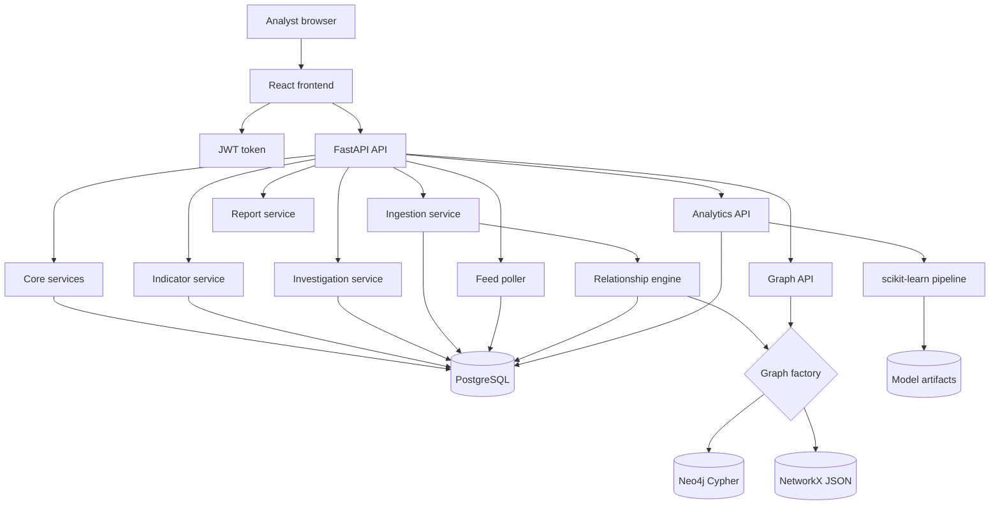

# THREATGRAPH

AI-Powered Cyber Attack Relationship Mapping and Prediction System.

Project folder: `threat-graph`

Repository: `https://github.com/Njbalamani/THREAT-GRAPH`

Author and license holder: **N J Bala Manikantan** (`n j bala manikantan`)

---

## Table of contents

1. [Overview](#overview)
2. [Prediction disclaimer](#prediction-disclaimer)
3. [What is included](#what-is-included)
4. [System architecture](#system-architecture)
5. [Technology stack](#technology-stack)
6. [Repository layout](#repository-layout)
7. [Quick start](#quick-start)
8. [Local development](#local-development)
9. [Docker deployment](#docker-deployment)
10. [Environment configuration](#environment-configuration)
11. [Default credentials](#default-credentials)
12. [Backend modules](#backend-modules)
13. [Frontend modules](#frontend-modules)
14. [Data flow](#data-flow)
15. [Ingestion details](#ingestion-details)
16. [Indicator registry](#indicator-registry)
17. [Graph storage and relationships](#graph-storage-and-relationships)
18. [Analytics and machine learning](#analytics-and-machine-learning)
19. [Investigations](#investigations)
20. [Reports and exports](#reports-and-exports)
21. [API reference](#api-reference)
22. [Authentication and roles](#authentication-and-roles)
23. [Validation and errors](#validation-and-errors)
24. [Sample datasets](#sample-datasets)
25. [Testing and verification](#testing-and-verification)
26. [Troubleshooting](#troubleshooting)
27. [Security guidance](#security-guidance)
28. [Operational guidance](#operational-guidance)
29. [Frequently asked questions](#frequently-asked-questions)
30. [License](#license)

---

## Overview

THREATGRAPH is a working full-stack platform for cyber attack relationship mapping and advisory prediction. It brings together indicator management, event ingestion, threat intelligence feeds, graph analysis, machine learning, investigation workflow, and reporting in one application.

The system is designed around a simple principle: evidence should be connected, but analytical conclusions must remain clearly labelled. A raw authentication failure, a malicious IP, a STIX indicator, and a domain observed in a log can all become nodes in a graph. The edges between them carry provenance so analysts can see whether a connection came directly from evidence or from an inference model.

The platform includes:

- a FastAPI backend
- a React frontend
- PostgreSQL persistence
- Neo4j graph persistence
- NetworkX graph fallback
- STIX and TAXII ingestion
- graph analytics
- scikit-learn risk scoring
- investigation cases
- PDF and dataset exports
- unit and integration tests
- Docker Compose deployment configuration

---

## Prediction disclaimer

Model predictions in this project are advisory.

They are not confirmed attacks, incidents, or attribution claims. The backend response and the user interface intentionally display:

- probability
- risk level
- explanation
- model version
- `prediction_only: true`
- `confirmed: false`

Analysts must validate predictions against evidence before using them for escalation.

This distinction is also applied to graph relationships:

| Relationship type | Meaning | Analyst treatment |
| --- | --- | --- |
| observed | Directly derived from ingested evidence | Evidence-backed link |
| inferred | Produced by analytical rules or similarity | Lead requiring validation |

---

## What is included

### Backend

- FastAPI application
- SQLAlchemy models
- Pydantic schemas
- JWT authentication
- role-based access control
- ingestion routers
- graph routers
- analytics routers
- investigation routers
- feed routers
- report and export routers
- error handlers
- configuration loader
- sample datasets
- pytest suite

### Frontend

- login screen
- dashboard
- ingestion workspace
- indicator registry
- graph explorer
- analytics and ML workspace
- investigations workspace
- feeds workspace
- reports workspace
- reusable UI components
- Cytoscape graph canvas
- Chart.js charts
- custom CSS theme

### Documentation

- root README
- inner README
- architecture diagram
- entity relationship diagram
- API reference
- deployment guide
- MIT license in both locations

### Deployment

- backend Dockerfile
- frontend Dockerfile
- nginx configuration
- Docker Compose stack with PostgreSQL, Neo4j, backend, and frontend
- CI workflow

---

## System architecture



### Component responsibilities

| Component | Responsibility |
| --- | --- |
| React frontend | Presents dashboards and analyst workflows |
| FastAPI API | Validates requests, enforces auth, orchestrates services |
| PostgreSQL | Stores users, indicators, events, jobs, relationships, cases, feeds, and model metadata |
| Neo4j | Stores graph nodes and edges using Cypher |
| NetworkX | Provides a persistent graph fallback when Neo4j is disabled |
| Relationship engine | Converts evidence into observed and inferred edges |
| ML pipeline | Builds features, trains models, produces advisory predictions |
| Feed poller | Pulls STIX, TAXII, JSON, CSV, and log feeds |
| Report service | Generates PDF and dataset exports |

---

## Technology stack

| Area | Choice |
| --- | --- |
| Backend language | Python 3.12 |
| Backend framework | FastAPI |
| ORM | SQLAlchemy 2.x |
| Validation | Pydantic 2.x |
| Password hashing | bcrypt |
| Tokens | python-jose JWT |
| Relational database | PostgreSQL |
| Graph database | Neo4j |
| Graph fallback | NetworkX |
| ML | scikit-learn, NumPy, joblib |
| PDF | ReportLab |
| Frontend | React 18, TypeScript |
| Build tool | Vite |
| Charts | Chart.js with react-chartjs-2 |
| Graph visualization | Cytoscape.js |
| Styling | Custom CSS |
| Testing | pytest, Ruff, TypeScript compiler |
| Reverse proxy | nginx |
| Containers | Docker and Docker Compose |

---

## Repository layout

```text
threat-graph/
├── .env.example
├── .gitignore
├── LICENSE
├── README.md
├── docker-compose.yml
├── backend
│   ├── .dockerignore
│   ├── Dockerfile
│   ├── app
│   │   ├── api
│   │   │   ├── analytics.py
│   │   │   ├── auth.py
│   │   │   ├── dashboard.py
│   │   │   ├── deps.py
│   │   │   ├── feeds.py
│   │   │   ├── graph.py
│   │   │   ├── indicators.py
│   │   │   ├── ingestion.py
│   │   │   ├── investigations.py
│   │   │   ├── reports.py
│   │   │   ├── router.py
│   │   │   └── system.py
│   │   ├── core
│   │   │   ├── config.py
│   │   │   ├── database.py
│   │   │   ├── errors.py
│   │   │   └── security.py
│   │   ├── graph
│   │   │   ├── base.py
│   │   │   ├── factory.py
│   │   │   ├── keys.py
│   │   │   ├── neo4j_store.py
│   │   │   ├── networkx_store.py
│   │   │   ├── relationships.py
│   │   │   └── types.py
│   │   ├── ingestion
│   │   │   ├── parsers.py
│   │   │   └── service.py
│   │   ├── ml
│   │   │   ├── features.py
│   │   │   └── pipeline.py
│   │   ├── models
│   │   │   ├── enums.py
│   │   │   ├── feed.py
│   │   │   ├── investigation.py
│   │   │   ├── threat.py
│   │   │   └── user.py
│   │   ├── schemas
│   │   │   ├── analytics.py
│   │   │   ├── auth.py
│   │   │   ├── feed.py
│   │   │   ├── graph.py
│   │   │   ├── investigation.py
│   │   │   └── threat.py
│   │   ├── services
│   │   │   ├── dashboard.py
│   │   │   ├── feed_poller.py
│   │   │   ├── graph_analytics.py
│   │   │   └── reports.py
│   │   └── main.py
│   ├── pyproject.toml
│   ├── pytest.ini
│   ├── requirements.txt
│   ├── sample_data
│   └── tests
├── docs
│   ├── api.md
│   ├── architecture.md
│   ├── deployment.md
│   └── er-diagram.md
└── frontend
    ├── .dockerignore
    ├── .env.example
    ├── Dockerfile
    ├── index.html
    ├── nginx.conf
    ├── package.json
    ├── package-lock.json
    ├── tsconfig.json
    ├── vite.config.ts
    └── src
        ├── App.tsx
        ├── api.ts
        ├── auth.tsx
        ├── main.tsx
        ├── styles.css
        ├── types.ts
        ├── components
        │   ├── GraphCanvas.tsx
        │   ├── Layout.tsx
        │   └── UI.tsx
        └── pages
            ├── Analytics.tsx
            ├── Dashboard.tsx
            ├── Feeds.tsx
            ├── GraphExplorer.tsx
            ├── Indicators.tsx
            ├── Ingestion.tsx
            ├── Investigations.tsx
            ├── Login.tsx
            └── Reports.tsx
```

---

## Quick start

### Docker quick start

From this `threat-graph` directory:

```powershell
docker compose up --build
```

Then open:

```text
Frontend:  http://localhost:5173
API:       http://localhost:8000
API docs:  http://localhost:8000/docs
Neo4j:     http://localhost:7474
```

### Local quick start

Start the backend:

```powershell
cd backend
python -m venv .venv
.\.venv\Scripts\python.exe -m pip install -r requirements.txt
$env:DATABASE_URL = "sqlite:///./threatgraph.db"
.\.venv\Scripts\python.exe -m uvicorn app.main:app --reload --port 8000
```

Start the frontend in another terminal:

```powershell
cd frontend
npm.cmd install
npm.cmd run dev
```

Open `http://localhost:5173`.

---

## Local development

### Backend setup

The backend uses a virtual environment and pinned dependencies.

```powershell
cd backend
python -m venv .venv
.\.venv\Scripts\python.exe -m pip install --upgrade pip
.\.venv\Scripts\python.exe -m pip install -r requirements.txt
```

Set environment variables for local development. On Windows PowerShell:

```powershell
$env:DATABASE_URL = "sqlite:///./threatgraph.db"
$env:SECRET_KEY = "local-development-secret"
$env:NEO4J_ENABLED = "false"
```

Start the API:

```powershell
.\.venv\Scripts\python.exe -m uvicorn app.main:app --reload --port 8000
```

Interactive documentation:

```text
http://localhost:8000/docs
```

### Frontend setup

```powershell
cd frontend
npm.cmd install
npm.cmd run dev
```

The Vite server listens on port 5173 by default. The frontend expects the API at `http://localhost:8000` unless `VITE_API_URL` is changed.

### Using npm on Windows

If PowerShell blocks `npm.ps1`, use `npm.cmd`:

```powershell
npm.cmd install
npm.cmd run build
npm.cmd run dev
```

---

## Docker deployment

The Docker Compose stack includes four services.

### PostgreSQL

Stores:

- users
- indicators
- security events
- graph relationship audit rows
- ingestion jobs
- feed configurations
- investigations
- investigation notes
- model run metadata

### Neo4j

Stores graph nodes and edges as real Cypher-managed relationships.

### Backend

Runs the FastAPI app with:

```text
uvicorn app.main:app --host 0.0.0.0 --port 8000
```

### Frontend

Builds the React app and serves it through nginx on port 5173.

### Start

```powershell
docker compose up --build
```

### Stop

```powershell
docker compose down
```

### Stop and remove data volumes

```powershell
docker compose down -v
```

Use the volume-removal command only when you intentionally want to delete local database and graph data.

---

## Environment configuration

Copy the example file:

```powershell
Copy-Item .env.example .env
```

### Configuration reference

| Variable | Example | Purpose |
| --- | --- | --- |
| `APP_NAME` | `ThreatGraph` | Application display name |
| `ENVIRONMENT` | `development` | Deployment environment label |
| `DEBUG` | `false` | FastAPI debug mode |
| `SECRET_KEY` | long random string | JWT signing secret |
| `ACCESS_TOKEN_EXPIRE_MINUTES` | `60` | Token lifetime |
| `DATABASE_URL` | PostgreSQL URL | SQLAlchemy database connection |
| `ADMIN_EMAIL` | `admin@threatgraph.local` | Initial administrator email |
| `ADMIN_PASSWORD` | `ChangeMe123!` | Initial administrator password |
| `ADMIN_FULL_NAME` | `ThreatGraph Administrator` | Initial administrator display name |
| `NEO4J_ENABLED` | `true` | Select Neo4j graph backend |
| `NEO4J_URI` | `bolt://localhost:7687` | Neo4j bolt URI |
| `NEO4J_USER` | `neo4j` | Neo4j username |
| `NEO4J_PASSWORD` | `threatgraph` | Neo4j password |
| `NEO4J_DATABASE` | `neo4j` | Neo4j database name |
| `GRAPH_STORAGE_PATH` | `storage/graph.json` | NetworkX fallback file |
| `MODEL_DIR` | `storage/models` | Model artifacts directory |
| `MAX_UPLOAD_MB` | `25` | Maximum upload size |
| `CORS_ORIGINS` | comma-separated origins | Allowed browser origins |
| `TAXII_DEFAULT_COLLECTION` | `default` | Default TAXII collection |

### Production values

Replace these before production:

```text
SECRET_KEY
ADMIN_EMAIL
ADMIN_PASSWORD
DATABASE_URL credentials
NEO4J_PASSWORD
CORS_ORIGINS
```

---

## Default credentials

Local development defaults:

```text
Username: admin@threatgraph.local
Password: ChangeMe123!
```

These are intentionally convenient for local testing. They are not safe for production.

The first administrator is created at application startup if it does not already exist.

---

## Backend modules

### `app/api`

Contains FastAPI routers:

| File | Purpose |
| --- | --- |
| `auth.py` | Login, current user, user creation, user listing |
| `dashboard.py` | Dashboard summary aggregation |
| `feeds.py` | Feed configuration and polling |
| `graph.py` | Graph stats, nodes, edges, snapshots, paths |
| `indicators.py` | Indicator CRUD and filtering |
| `ingestion.py` | Upload, text ingestion, job history |
| `investigations.py` | Cases, notes, indicators, timeline |
| `reports.py` | PDF and dataset exports |
| `system.py` | Health and sample seeding |
| `analytics.py` | Relationship rebuild, analysis, training, predictions |
| `deps.py` | Authentication and RBAC dependencies |

### `app/core`

Contains infrastructure:

| File | Purpose |
| --- | --- |
| `config.py` | Settings loaded from environment and `.env` |
| `database.py` | Engine, sessions, table initialization |
| `security.py` | JWT creation, password hashing, verification |
| `errors.py` | Application error types |

### `app/graph`

Contains graph storage and relationship logic:

| File | Purpose |
| --- | --- |
| `base.py` | Graph store interface |
| `networkx_store.py` | Persistent NetworkX MultiDiGraph store |
| `neo4j_store.py` | Cypher-based Neo4j store |
| `factory.py` | Store selection and fallback |
| `keys.py` | Stable graph key generation |
| `types.py` | Graph node and edge data structures |
| `relationships.py` | Observed and inferred relationship construction |

### `app/ingestion`

Contains:

- format detection
- JSON parsing
- CSV parsing
- log parsing
- STIX parsing
- IOC extraction
- ingestion orchestration
- deduplication
- job tracking

### `app/ml`

Contains:

- feature extraction
- RandomForest classifier training
- KMeans clustering
- prediction generation
- explanation construction
- model versioning

### `app/services`

Contains cross-module services:

- graph analytics
- dashboard aggregation
- feed polling
- reports and exports

### `app/models`

SQLAlchemy models:

- `User`
- `Indicator`
- `SecurityEvent`
- `GraphRelationship`
- `IngestionJob`
- `FeedConfig`
- `MLModelRun`
- `Investigation`
- `InvestigationNote`
- association tables

### `app/schemas`

Pydantic request and response contracts for all API surfaces.

---

## Frontend modules

### `src/pages`

| File | Screen |
| --- | --- |
| `Login.tsx` | Authentication screen |
| `Dashboard.tsx` | KPI cards, charts, recent activity, model status |
| `Ingestion.tsx` | Upload, paste text, seed samples, job history |
| `Indicators.tsx` | Search, filter, create, edit, delete indicators |
| `GraphExplorer.tsx` | Cytoscape canvas, provenance filters, paths, neighborhoods |
| `Analytics.tsx` | Rebuild, analyze, train, predictions, clusters, anomalies |
| `Investigations.tsx` | Case list, detail, linked indicators, notes, timeline |
| `Feeds.tsx` | Feed list, create, edit, enable, poll, delete |
| `Reports.tsx` | PDF generation and dataset exports |

### `src/components`

| File | Purpose |
| --- | --- |
| `Layout.tsx` | Sidebar, topbar, footer, API status |
| `UI.tsx` | Badges, banners, modals, cards, fields, empty states |
| `GraphCanvas.tsx` | Cytoscape.js graph rendering and node selection |

### Core frontend files

| File | Purpose |
| --- | --- |
| `api.ts` | Typed HTTP client and endpoint helpers |
| `auth.tsx` | Auth context, token state, role helpers |
| `types.ts` | TypeScript API contracts |
| `styles.css` | Complete custom dark theme |
| `App.tsx` | Routes and protected layout |
| `main.tsx` | React root and providers |

---

## Data flow

### Ingestion flow

```text
File, text, or feed
  -> format detection
  -> parser
  -> IOC extraction
  -> validation
  -> indicator deduplication
  -> security event creation
  -> ingestion job update
  -> relationship engine
  -> graph store
  -> API response
  -> UI refresh
```

### Investigation flow

```text
Create case
  -> link indicators
  -> add notes
  -> update status or priority
  -> timeline aggregation
  -> PDF report with selected scope
```

### ML flow

```text
Indicators + events + graph features
  -> feature rows
  -> label source selection
  -> train/test split
  -> RandomForest pipeline
  -> KMeans clustering
  -> metrics and model version
  -> prediction rows with explanations
  -> UI advisory table
```

---

## Ingestion details

### Supported formats

| Format | Detection | Notes |
| --- | --- | --- |
| JSON | file extension and content | event records and STIX bundles |
| CSV | file extension | tabular event records |
| TXT / LOG | file extension | raw IOC extraction |
| STIX | bundle type | indicators and observed data |

### Extracted IOC types

- IPv4 addresses
- IPv6 addresses
- domains
- URLs
- SHA-256 hashes
- SHA-1 hashes
- MD5 hashes
- email addresses

### Job fields

Each ingestion job records:

- source
- filename
- format
- status
- total records
- imported indicators
- imported events
- rejected records
- validation errors
- created time
- completed time

---

## Indicator registry

Indicators are deduplicated by type and value.

Fields include:

- type
- value
- severity
- confidence
- source
- description
- tags
- STIX ID
- confirmation state
- first seen
- last seen
- raw evidence

The UI supports:

- search
- type filter
- severity filter
- create
- edit
- delete for admins
- analyst confirmation

---

## Graph storage and relationships

### Graph stores

The graph factory chooses one of two stores:

1. Neo4j store when `NEO4J_ENABLED=true`
2. NetworkX JSON store otherwise or as fallback

### Node types

Common node keys and types:

- indicator nodes
- event nodes
- domain nodes
- unknown placeholder nodes

### Observed edges

Observed edges come from evidence in events, such as:

- source IP linked to an event
- destination IP linked to an event
- domain observed in an event
- hash transferred in an event
- URL observed in an event
- email contact observed in an event

### Inferred edges

Inferred edges are analytical candidates, such as:

- shared domain
- shared hash
- similar behaviour

### Provenance rule

Every edge has one provenance:

```text
observed or inferred
```

The UI renders observed edges as solid and inferred edges as dashed.

---

## Analytics and machine learning

### Graph analytics

The graph analyzer computes:

- communities
- important nodes
- anomalous links
- graph backend metadata
- generated timestamp

### ML features

Feature engineering uses:

- indicator severity
- confidence
- confirmation state
- indicator age
- event recency
- graph degree
- community information
- source reputation signals

### Model

The classifier is a scikit-learn pipeline:

- standardization
- RandomForestClassifier
- balanced class weighting

### Clustering

KMeans groups indicators into clusters when enough rows are available.

### Prediction fields

Predictions include:

- indicator ID
- indicator value
- type
- probability
- risk level
- cluster ID
- cluster size
- confirmed
- prediction only
- explanation
- model version

Predictions are deliberately advisory and never represented as confirmed incidents.

---

## Investigations

Investigation cases include:

- title
- description
- status
- priority
- owner
- linked indicators
- notes
- timeline
- created time
- updated time

### Statuses

```text
open
in_progress
resolved
closed
```

### Priorities

```text
low
medium
high
critical
```

### Typical workflow

1. Create a case.
2. Link indicators from the registry.
3. Add analyst notes.
4. Change status as work progresses.
5. Review timeline.
6. Generate a scoped PDF report.

---

## Reports and exports

### PDF report options

- report title
- investigation scope
- indicator selection
- minimum severity
- include or exclude predictions

### Exports

| Export | Format |
| --- | --- |
| Indicators | CSV |
| Relationships | CSV |
| Graph | JSON |
| Graph | GraphML |

Downloads are performed with the authenticated session.

---

## API reference

Base URL:

```text
http://localhost:8000
```

Interactive docs:

```text
http://localhost:8000/docs
```

### Authentication

| Method | Path | Purpose |
| --- | --- | --- |
| POST | `/api/auth/login` | Login with form data |
| GET | `/api/auth/me` | Current user |
| POST | `/api/auth/register` | Create user, admin only |
| GET | `/api/auth/users` | List users, admin only |

### System

| Method | Path | Purpose |
| --- | --- | --- |
| GET | `/api/system/health` | Public health |
| POST | `/api/system/seed-samples` | Seed sample data |
| GET | `/api/dashboard/summary` | Dashboard aggregate |

### Indicators

| Method | Path | Purpose |
| --- | --- | --- |
| GET | `/api/indicators` | List indicators |
| GET | `/api/indicators/{id}` | Get indicator |
| POST | `/api/indicators` | Create indicator |
| PATCH | `/api/indicators/{id}` | Update indicator |
| DELETE | `/api/indicators/{id}` | Delete indicator |

### Ingestion

| Method | Path | Purpose |
| --- | --- | --- |
| POST | `/api/ingestion/upload` | Upload dataset |
| POST | `/api/ingestion/text` | Ingest pasted text |
| GET | `/api/ingestion/jobs` | List jobs |
| GET | `/api/ingestion/jobs/{id}` | Job detail |

### Graph

| Method | Path | Purpose |
| --- | --- | --- |
| GET | `/api/graph/stats` | Graph statistics |
| GET | `/api/graph/nodes` | List nodes |
| GET | `/api/graph/edges` | List edges |
| GET | `/api/graph/snapshot` | Full snapshot |
| GET | `/api/graph/neighbors` | N-hop neighborhood |
| POST | `/api/graph/path` | Shortest path |

### Analytics

| Method | Path | Purpose |
| --- | --- | --- |
| POST | `/api/analytics/graph/rebuild` | Rebuild relationships |
| POST | `/api/analytics/graph/analyze` | Analyze graph |
| POST | `/api/analytics/model/train` | Train model |
| GET | `/api/analytics/model` | Model metadata |
| GET | `/api/analytics/predictions` | Advisory predictions |

### Investigations

| Method | Path | Purpose |
| --- | --- | --- |
| GET | `/api/investigations` | List cases |
| POST | `/api/investigations` | Create case |
| GET | `/api/investigations/{id}` | Case detail |
| PATCH | `/api/investigations/{id}` | Update case |
| DELETE | `/api/investigations/{id}` | Delete case |
| POST | `/api/investigations/{id}/indicators/{indicator_id}` | Link indicator |
| POST | `/api/investigations/{id}/notes` | Add note |
| GET | `/api/investigations/{id}/timeline` | Timeline |

### Feeds

| Method | Path | Purpose |
| --- | --- | --- |
| GET | `/api/feeds` | List feeds |
| POST | `/api/feeds` | Create feed |
| PATCH | `/api/feeds/{id}` | Update feed |
| DELETE | `/api/feeds/{id}` | Delete feed |
| POST | `/api/feeds/{id}/poll` | Poll one feed |
| POST | `/api/feeds/poll-enabled` | Poll enabled feeds |

### Reports

| Method | Path | Purpose |
| --- | --- | --- |
| POST | `/api/reports/pdf` | Generate PDF |
| GET | `/api/exports/indicators.csv` | Export indicators |
| GET | `/api/exports/relationships.csv` | Export relationships |
| GET | `/api/exports/graph.json` | Export graph JSON |
| GET | `/api/exports/graph.graphml` | Export GraphML |

---

## Authentication and roles

Roles:

| Role | Capabilities |
| --- | --- |
| admin | Full access, user management, feed configuration, deletion |
| analyst | Ingestion, analysis, model training, investigation changes |
| viewer | Read-only access |

Protected endpoints use bearer tokens.

Login request format:

```text
application/x-www-form-urlencoded
username=...
password=...
```

Response:

```json
{
  "access_token": "jwt-token",
  "token_type": "bearer"
}
```

Use the token as:

```text
Authorization: Bearer <access_token>
```

---

## Validation and errors

The API validates request bodies using Pydantic.

Common validation rules:

- indicator value is required
- confidence must be between 0 and 1
- investigation title must be at least 3 characters
- feed URLs require a valid length
- text ingestion content must be at least 2 characters
- upload size is limited by `MAX_UPLOAD_MB`

Error format:

```json
{
  "error": {
    "code": "validation_error",
    "message": "Request validation failed",
    "details": []
  }
}
```

Other error codes include:

- `unauthorized`
- `forbidden`
- `not_found`
- `conflict`
- `database_error`

---

## Sample datasets

The bundled sample datasets are:

```text
backend/sample_data/sample_events.json
backend/sample_data/sample_events.csv
backend/sample_data/sample_logs.txt
backend/sample_data/sample_stix_bundle.json
```

Seed them from the UI using the Ingestion page, or call:

```http
POST /api/system/seed-samples
```

This requires analyst or admin access.

---

## Testing and verification

### Backend

From `backend`:

```powershell
.\.venv\Scripts\python.exe -m ruff format --check .
.\.venv\Scripts\python.exe -m ruff check .
.\.venv\Scripts\python.exe -m compileall -q app
.\.venv\Scripts\python.exe -m pytest
```

Expected result:

```text
9 passed
```

### Frontend

From `frontend`:

```powershell
npm.cmd run typecheck
npm.cmd run build
```

Expected result:

- no TypeScript errors
- production bundle created in `frontend/dist`

### YAML

The following files are structurally valid YAML:

```text
docker-compose.yml
.github/workflows/ci.yml
```

---

## Troubleshooting

### Frontend cannot reach backend

Check:

- backend is running on port 8000
- `VITE_API_URL` matches the API origin
- CORS includes `http://localhost:5173`
- browser token is present
- token has not expired

### Login fails

Check:

- default credentials are correct for local use
- administrator seed ran at startup
- `ADMIN_EMAIL` and `ADMIN_PASSWORD` were not changed unexpectedly
- database is reachable

### Database connection fails

Check:

- `DATABASE_URL`
- PostgreSQL container health
- credentials
- network name in Docker Compose
- SQLite path permissions for local mode

### Neo4j connection fails

Check:

- `NEO4J_ENABLED`
- `NEO4J_URI`
- `NEO4J_USER`
- `NEO4J_PASSWORD`
- Neo4j health
- whether fallback to NetworkX is acceptable

### Graph is empty

Ingest data first:

- seed samples
- upload JSON, CSV, or log data
- paste indicators
- poll a configured feed

Then rebuild relationships from the Analytics screen.

### No predictions

Train a model after at least two indicators are available. If labels are heuristically generated, the UI will note that predictions are exploratory.

### Port conflicts

Change host ports in `docker-compose.yml` or stop conflicting services.

### npm script blocked on Windows

Use `npm.cmd` instead of `npm`.

---

## Security guidance

### Required before production

- replace the JWT secret
- replace administrator credentials
- replace database passwords
- replace Neo4j credentials
- restrict CORS
- enable HTTPS
- restrict network access to databases
- validate feed sources
- rotate credentials periodically
- back up databases and artifacts

### Data handling

The platform stores raw evidence and extracted indicators. Treat ingested data as security-sensitive.

### Role design

Use viewer accounts for users who only need dashboards and graph exploration. Use analyst accounts for ingestion and investigation work. Reserve admin accounts for configuration and user management.

### Secrets

Never commit:

- `.env`
- private keys
- production passwords
- API tokens
- local database files

---

## Operational guidance

### Backups

Back up together:

- PostgreSQL volume
- Neo4j volume
- NetworkX graph file
- model artifact directory
- environment configuration stored securely outside the repository

### Monitoring

Monitor:

- backend health endpoint
- ingestion job failures
- feed last status
- Neo4j availability
- PostgreSQL availability
- model training runs
- disk usage for graph and model artifacts

### Upgrade procedure

1. Stop the stack.
2. Back up volumes and artifacts.
3. Pull new code.
4. Rebuild images.
5. Start the stack.
6. Verify health and login.
7. Verify graph and model paths.

---

## Frequently asked questions

### Is this only a dashboard?

No. The backend ingests, validates, stores, relates, analyzes, trains, predicts, investigates, and exports.

### Are predictions confirmed attacks?

No. They are advisory scores with explanations and must be verified by analysts.

### Does it use a real graph database?

Yes. Neo4j is supported with Cypher relationships. NetworkX is a fallback for local or lightweight deployments.

### Can it import STIX?

Yes. JSON files containing STIX bundles are parsed, and STIX/TAXII feeds can be configured.

### Can it use custom CSS instead of Bootstrap?

Yes. The frontend uses custom CSS only.

### Is there an investigation workflow?

Yes. Cases support linked indicators, notes, status, priority, and timeline.

### Are there sample datasets?

Yes. Four sample files can be seeded from the Ingestion screen.

### Can reports be exported?

Yes. PDF reports and CSV, JSON, and GraphML exports are available.

### What is the license?

MIT License. Copyright holder: **N J Bala Manikantan**.

---

## License

MIT License

Copyright (c) 2026 **N J Bala Manikantan**

The full license text is available at:

```text
threat-graph/LICENSE
```
