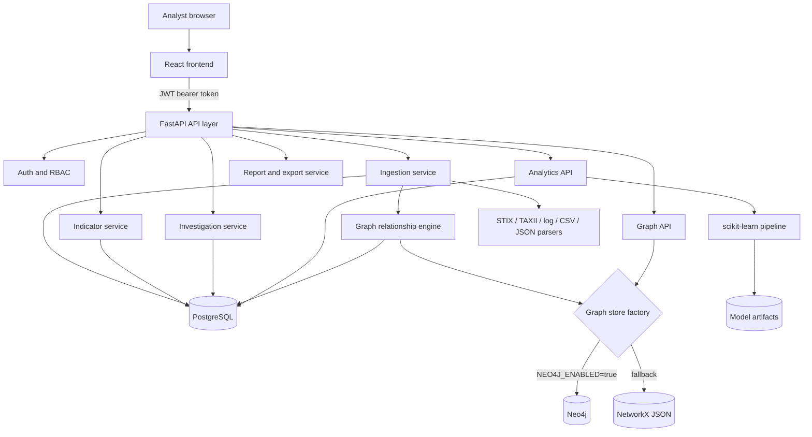

# Architecture

## System flow

## Module responsibilities

| Module | Responsibility |
| --- | --- |
| `app/api` | HTTP endpoints, request validation, dependency-based authorization |
| `app/core` | Settings, database sessions, password hashing, JWT, error handlers |
| `app/models` | Persistent entities in PostgreSQL |
| `app/schemas` | Pydantic request and response contracts |
| `app/ingestion` | Content detection, IOC extraction, STIX parsing, job tracking |
| `app/graph` | Graph stores, Cypher/NetworkX operations, relationship construction |
| `app/services` | Cross-module analytics, dashboard aggregation, feed polling, reports |
| `app/ml` | Feature extraction, training, prediction, clustering, explanations |
| `frontend/src/pages` | Dashboard and investigation workspace screens |
| `frontend/src/components` | Shared UI primitives and Cytoscape integration |

## Relationship model

Observed edges are created directly from evidence in ingested events, such as a source IP linked to an authentication failure or a hash transferred in an event. Inferred edges are analytical candidates produced by graph analytics, such as shared-domain or similar-behaviour links.

The UI and exports always include provenance. Predictions from the ML pipeline include `prediction_only`, `confirmed`, `probability`, and explanation fields so they cannot be mistaken for confirmed incidents.

## Deployment topology

Docker Compose runs PostgreSQL, Neo4j, the FastAPI backend, and the nginx-served React frontend. The backend is the only service that talks to the databases. The browser talks to the backend over HTTP with a bearer token.

For production, terminate TLS at a reverse proxy, set a strong `SECRET_KEY`, replace default administrator credentials, restrict CORS origins, and use managed PostgreSQL and Neo4j instances.
